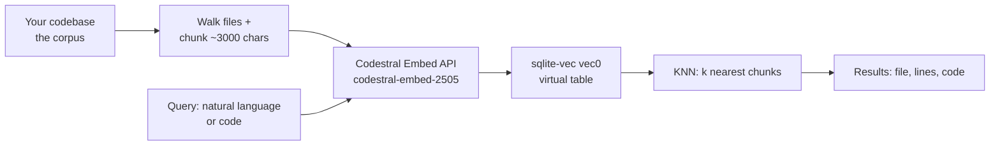

Let me check the current details on Codestral Embed's API before walking you through the setup.Let me grab the exact API usage details from Mistral's docs.The key facts are confirmed. Since the natural deliverable here is a working example script, let me load the canvas guidance before producing it.Now I'll create a runnable reference implementation as a code canvas.One correction to the indexing logic — the rowid-to-vector mapping needs to be deterministic:
"""
Semantic code search over a local codebase.

  Indexing :  walk a repo -> chunk files -> embed chunks with Mistral's
              `codestral-embed-2505` -> store vectors in sqlite-vec.
  Searching:  embed the query (natural language OR code) -> KNN lookup in
              sqlite-vec -> print the most similar chunks.

Usage:
    export MISTRAL_API_KEY="..."
    pip install mistralai sqlite-vec

    python code_search.py index  /path/to/repo   --db codesearch.db
    python code_search.py search "retry logic for failed uploads" --db codesearch.db
    python code_search.py search "SELECT ..." --db codesearch.db --k 10

Design notes:
    * Chunks live in a regular `chunks` table; vectors live in a `vec0`
      virtual table. They share rowids, so a KNN hit joins back to the text.
    * Codestral Embed dimensions are ordered by relevance, so you can
      truncate client-side (TRUNCATE_DIM) to shrink the index with a mild
      quality trade-off. Set it once at index time and use the same value
      at query time.
    * Chunking uses Mistral's recommended 3,000 chars with 1,000 overlap.
"""

import argparse
import os
import sqlite3
import sys
import time
from pathlib import Path

import sqlite_vec
from sqlite_vec import serialize_float32
from mistralai import Mistral

MODEL = "codestral-embed-2505"
TRUNCATE_DIM = None      # None = full size; e.g. 768 or 256 to shrink index
BATCH_SIZE = 64           # chunks per embeddings API call
K_DEFAULT = 5

# Only index files these extensions (add more to taste)
CODE_EXTENSIONS = {
    ".py", ".js", ".ts", ".tsx", ".jsx", ".java", ".kt", ".kts", ".go",
    ".rs", ".c", ".h", ".cpp", ".hpp", ".cs", ".rb", ".php", ".swift",
    ".m", ".mm", ".scala", ".sh", ".sql", ".html", ".css", ".md",
}

SKIP_DIRS = {
    ".git", ".hg", ".svn", "node_modules", "__pycache__", ".venv", "venv",
    "dist", "build", "target", ".next", ".idea", ".vscode", "vendor",
}

# ----------------------------------------------------------------------
# Embedding helper
# ----------------------------------------------------------------------

def embed(client, texts):
    """Embed a list of strings. Returns a list of float lists."""
    vectors = []
    for i in range(0, len(texts), BATCH_SIZE):
        batch = texts[i : i + BATCH_SIZE]
        response = client.embeddings.create(model=MODEL, inputs=batch)
        # Response preserves input order
        for item in response.data:
            vec = item.embedding
            if TRUNCATE_DIM:
                vec = vec[:TRUNCATE_DIM]
            vectors.append(vec)
    return vectors

# ----------------------------------------------------------------------
# Chunking
# ----------------------------------------------------------------------

def chunk_text(text, size=3000, overlap=1000):
    """Fixed-size character windows with overlap (Mistral's recommendation).

    Codestral Embed accepts up to 8,192 tokens per input, so 3,000 chars is a
    safe upper bound that also keeps chunks focused for retrieval.
    """
    step = size - overlap
    chunks = []
    start = 0
    while start < len(text):
        end = start + size
        piece = text[start:end]
        if piece.strip():
            first_line = text.count("\n", 0, start) + 1
            last_line = text.count("\n", 0, end) + 1
            chunks.append((first_line, last_line, piece))
        if end >= len(text):
            break
        start += step
    if not chunks and text.strip():
        chunks.append((1, text.count("\n") + 1, text))
    return chunks

def iter_code_files(root):
    for dirpath, dirnames, filenames in os.walk(root):
        dirnames[:] = [d for d in dirnames if d not in SKIP_DIRS]
        for name in sorted(filenames):
            path = Path(dirpath) / name
            if path.suffix.lower() in CODE_EXTENSIONS:
                yield path

# ----------------------------------------------------------------------
# Database
# ----------------------------------------------------------------------

def connect(db_path):
    conn = sqlite3.connect(db_path)
    conn.enable_load_extension(True)
    sqlite_vec.load(conn)
    conn.enable_load_extension(False)
    return conn

def ensure_schema(conn, dim):
    conn.execute(
        """
        create table if not exists chunks (
            rowid integer primary key,
            path text not null,
            start_line integer not null,
            end_line integer not null,
            text text not null
        )
        """
    )
    # vec0 virtual table: vectors keyed by the same rowid as `chunks`.
    conn.execute(
        f"create virtual table if not exists vec_chunks "
        f"using vec0(embedding float[{dim}])"
    )
    conn.execute(
        "create table if not exists meta (key text primary key, value text)"
    )
    conn.execute(
        "insert or replace into meta values ('dim', ?)", (str(dim),)
    )
    conn.commit()

# ----------------------------------------------------------------------
# Index command
# ----------------------------------------------------------------------

def cmd_index(args):
    client = Mistral(api_key=os.environ["MISTRAL_API_KEY"])
    root = Path(args.repo).resolve()
    conn = connect(args.db)

    # ---- Pass 1: collect all chunks ----------------------------------
    print(f"Scanning {root} ...")
    records = []  # (path, start_line, end_line, text)
    for path in iter_code_files(root):
        try:
            text = path.read_text(encoding="utf-8", errors="ignore")
        except OSError:
            continue
        rel = str(path.relative_to(root))
        for start_line, end_line, piece in chunk_text(text):
            records.append((rel, start_line, end_line, piece))

    if not records:
        print("No indexable code found.")
        return
    print(f"{len(records)} chunks from the corpus. Embedding...")

    # ---- Pass 2: embed in batches, insert ------------------------------
    started = time.time()
    dim_seen = None
    for i in range(0, len(records), BATCH_SIZE):
        batch = records[i : i + BATCH_SIZE]
        # New chunks get sequential rowids: prev_max+1 .. prev_max+len(batch)
        prev_max = conn.execute(
            "select coalesce(max(rowid), 0) from chunks"
        ).fetchone()[0]
        conn.executemany(
            "insert into chunks(path, start_line, end_line, text) "
            "values (?, ?, ?, ?)",
            batch,
        )
        vectors = embed(client, [r[3] for r in batch])
        if dim_seen is None:
            dim_seen = len(vectors[0])
            ensure_schema(conn, dim_seen)
            print(f"Embedding dimension: {dim_seen}")
        new_rowids = range(prev_max + 1, prev_max + 1 + len(batch))
        conn.executemany(
            "insert into vec_chunks(rowid, embedding) values (?, ?)",
            [
                (rowid, serialize_float32(vec))
                for rowid, vec in zip(new_rowids, vectors)
            ],
        )
        conn.commit()
        done = min(i + BATCH_SIZE, len(records))
        print(f"  {done}/{len(records)} chunks embedded")

    print(f"Done in {time.time() - started:.1f}s. Index: {args.db}")

# ----------------------------------------------------------------------
# Search command
# ----------------------------------------------------------------------

def cmd_search(args):
    client = Mistral(api_key=os.environ["MISTRAL_API_KEY"])
    conn = connect(args.db)

    dim = int(
        conn.execute("select value from meta where key = 'dim'").fetchone()[0]
    )
    query_vec = embed(client, [args.query])[0]
    if len(query_vec) != dim:
        query_vec = query_vec[:dim]

    rows = conn.execute(
        """
        select c.path, c.start_line, c.end_line, c.text, v.distance
        from vec_chunks v
        join chunks c on c.rowid = v.rowid
        where v.embedding match ?
          and k = ?
        order by v.distance
        """,
        (serialize_float32(query_vec), args.k),
    ).fetchall()

    if not rows:
        print("No matches.")
        return

    for rank, (path, start_line, end_line, text, distance) in enumerate(
        rows, start=1
    ):
        print(f"\n{rank}. {path}:{start_line}-{end_line}  (distance={distance:.4f})")
        preview = text[:500].rstrip()
        print("   " + preview.replace("\n", "\n   "))

# ----------------------------------------------------------------------

def main():
    parser = argparse.ArgumentParser(description="Local semantic code search")
    sub = parser.add_subparsers(dest="command", required=True)

    p_index = sub.add_parser("index", help="Index a repository")
    p_index.add_argument("repo", help="Path to the repository root")
    p_index.add_argument("--db", default="codesearch.db")
    p_index.set_defaults(func=cmd_index)

    p_search = sub.add_parser("search", help="Semantic search")
    p_search.add_argument("query", help="Natural language or code snippet")
    p_search.add_argument("--db", default="codesearch.db")
    p_search.add_argument("--k", type=int, default=K_DEFAULT)
    p_search.set_defaults(func=cmd_search)

    args = parser.parse_args()
    if "MISTRAL_API_KEY" not in os.environ:
        sys.exit("Set the MISTRAL_API_KEY environment variable first.")
    args.func(args)

if __name__ == "__main__":
    main()

I've put a complete, runnable reference implementation in the **"Codebase semantic search: Codestral Embed + sqlite-vec"** canvas — a single Python script with `index` and `search` commands you can adapt. Here's how the pieces fit together:

## The pipeline

## Key facts about Codestral Embed

- The API model name is **`codestral-embed-2505`**, priced at **$0.15 per million tokens**, so indexing even a large repo costs cents ([Mistral AI](https://mistral.ai/news/codestral-embed/))
- It's trained specifically for code, and accepts **either natural language or code** as the query — so "where do we handle retries?" can find the retry loop in `upload.py` ([Mistral AI](https://mistral.ai/news/codestral-embed/))
- Mistral recommends chunking at **3,000 characters with 1,000 overlap**, within the model's 8,192-token input limit ([Vercel AI Gateway](https://vercel.com/ai-gateway/models/codestral-embed))
- Its dimensions are **ordered by relevance**: you can truncate vectors client-side (even down to 256 dims) to shrink the index with a modest quality trade-off — the script exposes this as `TRUNCATE_DIM` ([Vercel AI Gateway](https://vercel.com/ai-gateway/models/codestral-embed))

## Key facts about sqlite-vec

- You load it as a SQLite extension and create a `vec0` **virtual table** holding the vectors, e.g. `create virtual table vec_chunks using vec0(embedding float[3072])` ([sqlite-vec GitHub](https://github.com/asg017/sqlite-vec))
- Queries use KNN syntax: `where embedding match ? and k = 5 order by distance` — the `match` value is your query vector serialized as raw floats ([Simon Willison](https://til.simonwillison.net/sqlite/sqlite-vec))
- The standard pattern (used in the script): a plain `chunks` table stores file path, line range, and source text; the `vec0` table shares its rowids, so a KNN hit joins back to the human-readable chunk

## What the script does

1. **`index`** — walks your repo (skipping `node_modules`, `.git`, etc.), chunks each file, embeds the chunks in batches via the Mistral SDK, and inserts text + vectors into one SQLite file.
2. **`search`** — embeds your query with the *same model*, runs the KNN match, and prints the top-k chunks with file path, line numbers, and distance.

One rule to remember: **queries must be embedded with the same model (and dimension) used at index time** — mixing models makes the vector spaces incomparable. And when your code changes, just re-run `index` against a fresh DB; incremental updates are a later optimization.

Mistral also has a [cookbook notebook](https://docs.mistral.ai/resources/cookbooks/mistral-embeddings-code_embedding) doing roughly this pipeline with FAISS instead of sqlite-vec, which is useful as a second reference.